#  Super Metroid Editor (SMEDIT)

The MS Paint of Super Metroid ROM hacking. A native cross-platform desktop editor built with Kotlin/Compose.

Work visually, write ASM, or move between both. Two-way data sync connects the code
and visual editors, with direct navigation between them. Build and playtest the same
project without leaving the app.


[Download](#download) · [Features](#features) · [Screenshots](#screenshots) · [Build from source](#building-from-source) · [Documentation](#documentation)

## Download

Get the latest release from [GitHub Releases](https://github.com/kennycason/super_metroid_editor/releases):
macOS (`.dmg`), Windows (`.msi`), or Linux (`.deb`). Releases include the Java runtime and Asar assembler.

## Getting Started

Bring your own Super Metroid ROM; no ROM is bundled.

1. Choose **NEW** to create a named project from your ROM, or **OPEN** an existing `.smedit` project.
2. Edit, then press **Run** to build and playtest. **EMU** shows or hides the emulator; **HEX** opens live memory inspection.
3. Save your project and export a ROM or IPS patch to share your changes. Your base ROM stays unchanged.

See [project setup](docs/project/project_format.md#project-root-and-opening-workflow) and
[ROM compatibility](docs/project/project_format.md#rom-compatibility-is-separate) for details.

<details>
<summary>Emulator controls</summary>

Focus the emulator for keyboard input, or use an SDL-compatible controller.

- **Keyboard:** arrows for D-pad; Z/X/A/S for B/A/Y/X; Q/W for L/R; Enter for Start; Shift or Tab for Select.
- **Controller save state:** R + Y + Select.
- **Controller load state:** L + Y + Select.
- **Controller change save slot:** L + R + Y + D-pad Up/Down.

</details>

## Features

- **Rooms & States** — Paint layouts, place items and enemies, edit conditional room states, create or clone rooms, and connect doors.
- **Room Generation** — Generate themed layouts and mazes, or remix existing rooms.
- **Tiles & FX** — Edit tile pixels, slopes and BTS properties, save reusable patterns, and configure water, lava, fog, and other room effects.
- **Sprites & Animations** — Edit Samus, enemies, bosses, projectiles, and title/intro/ending artwork with live previews.
- **Community Sprites** — Browse the attributed MapRandoSprites catalog, preview characters and animations, and use them in your project.
- **Minimap Editor** — Paint pause maps, position rooms, and edit station reveal data.
- **Patches & Tuning** — Manage IPS patches and tune Samus physics, enemy/boss stats, drops, vulnerabilities, beam damage, and more.
- **ASM Workspace** — Annotated disassembly, code completion, definitions and usages, split views, custom modules, an instruction library, and integrated Asar builds.
- **Emulator & Hex Editor** — Play with controller support and save states; inspect and edit live game memory with named bookmarks.
- **Sound & Text** — Browse and preview SPC music and edit in-game text.
- **Projects & Export** — Non-destructive `.smedit` projects, Undo/Redo, validation, and ROM or IPS export.

## Screenshots

### Room Editing & Image Export

<p>
  
  
</p>
<p>
  
  
</p>

### ASM ↔ Visual Editor

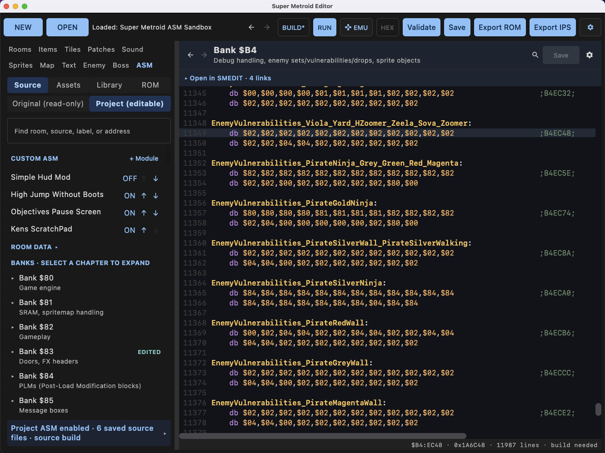

<p>
  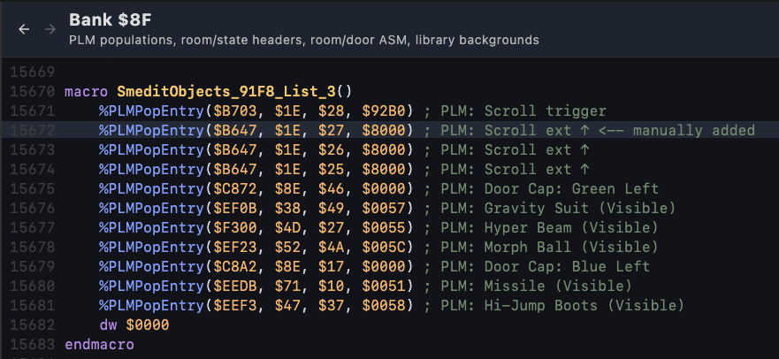
  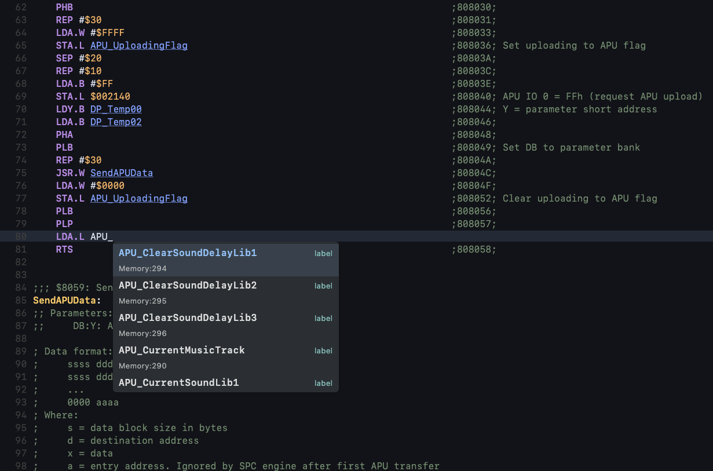
</p>

### Emulator & Live Hex Editor

<p>
  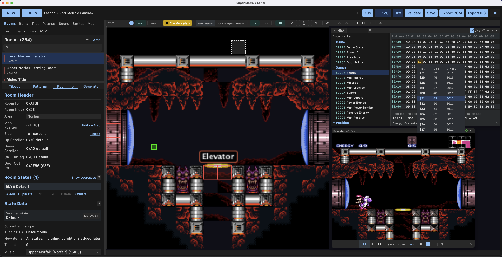
  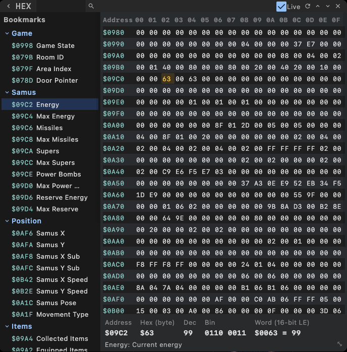
</p>

### Community Sprites

Prime Series Samus by Mattroid and Kirby by Wandering Spider, from the community catalog.

<p>
  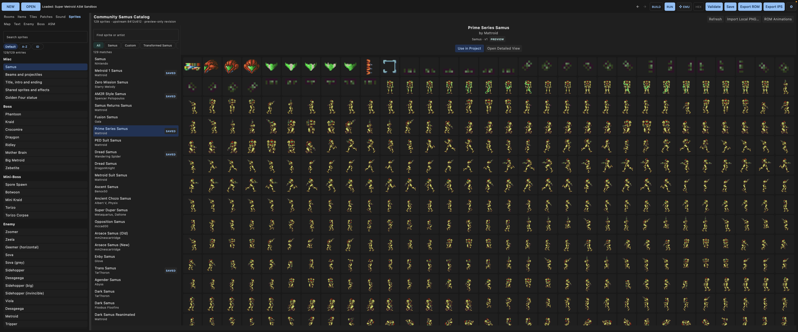
  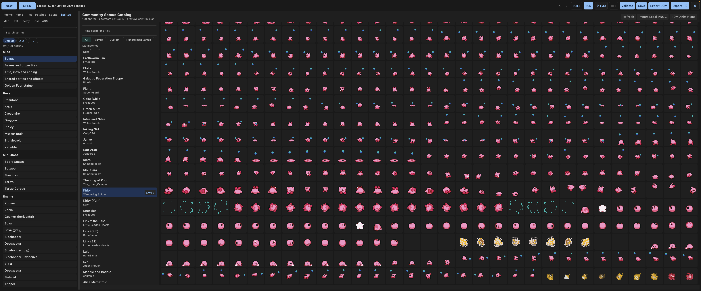
</p>

### Tiles, Pixels & Slopes

<p>
  
  
</p>
<p>
  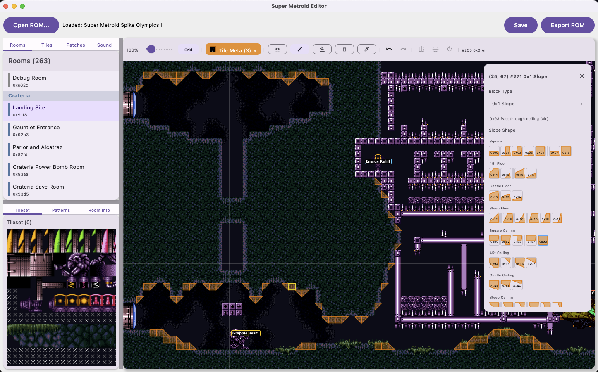
  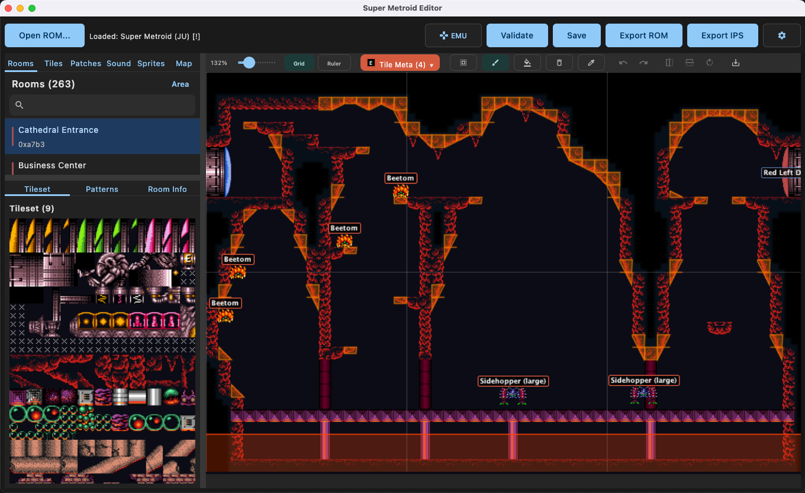
</p>

### Layer 3 FX

<p>
  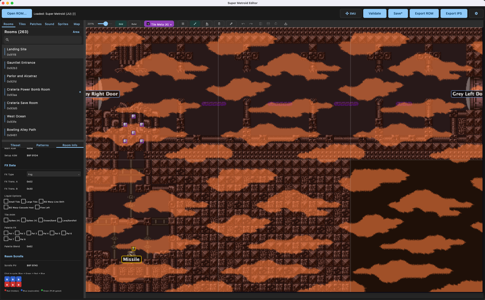
  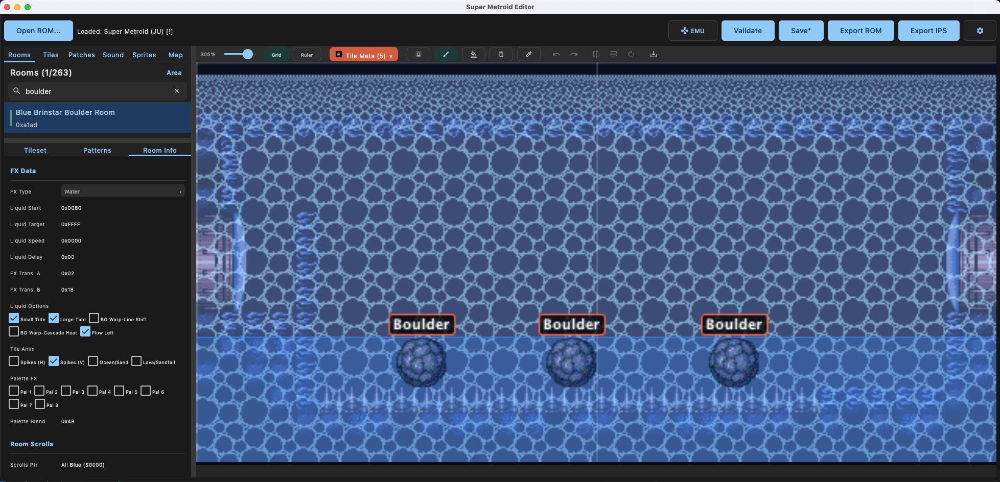
</p>

### Sprites & Artwork

<p>
  
  
</p>
<p>
  
  
</p>
<p>
  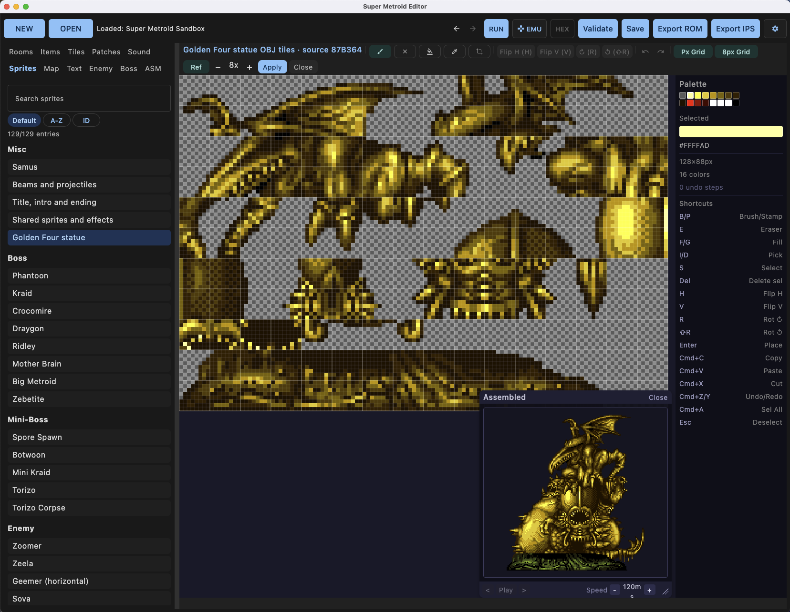
  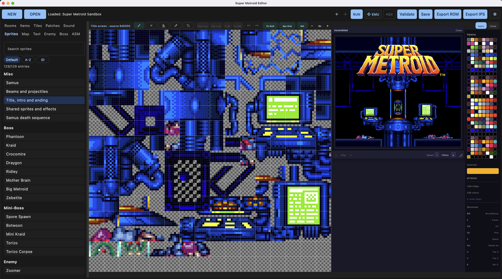
</p>

### Minimap

<p>
  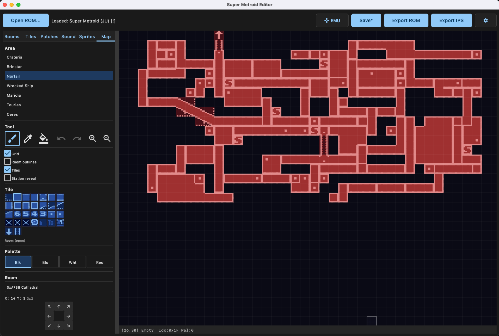
  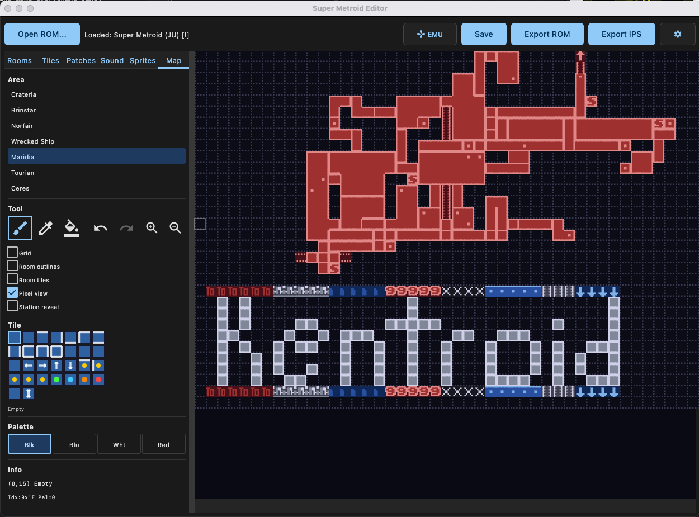
</p>

### Patches & Tuning

<p>
  
  
</p>
<p>
  
  
</p>
<p>
  
</p>

### Sound

<p>
  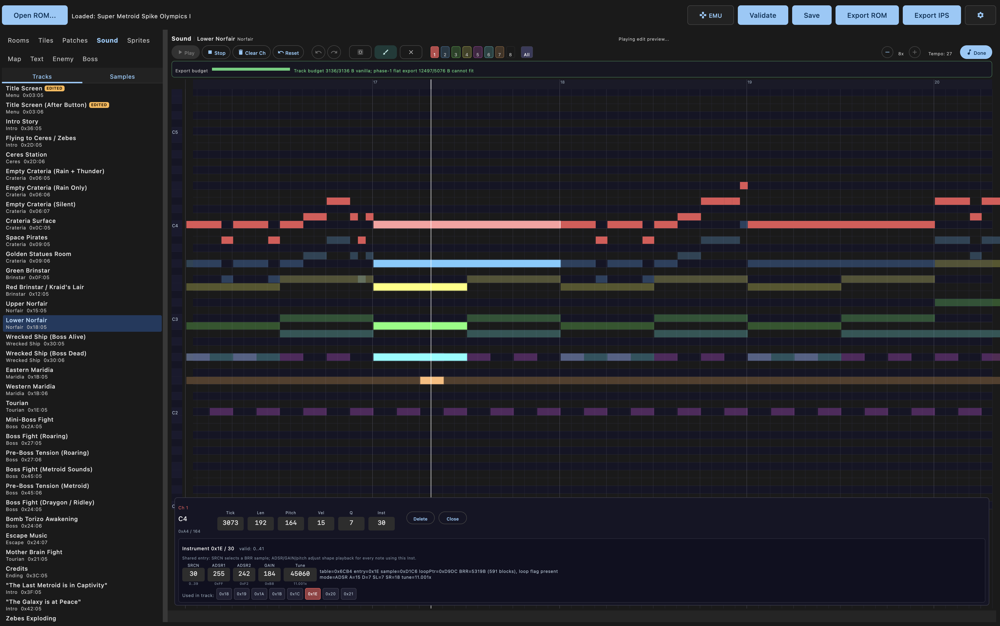
  
</p>

## Building from Source

Requires JDK 17, Git, CMake, and a C++ compiler (Xcode Command Line Tools on macOS,
`g++` on Linux, or MinGW on Windows). Gradle builds the native audio and emulator libraries.

```bash
git clone --recurse-submodules https://github.com/kennycason/super_metroid_editor.git
cd super_metroid_editor

# Run the editor
./gradlew :desktopApp:run

# Run tests
./gradlew :shared:jvmTest :desktopApp:jvmTest

# Package for your platform
./gradlew :desktopApp:packageDistributionForCurrentOS
```

Already cloned? Run `git submodule update --init --recursive` to fetch the native dependencies.

Source-backed regression tests use private ROM fixtures. See the [parity setup](parity/README.md)
and [validation matrix](docs/validation/README.md) for setup, focused checks, and reports.

## Documentation

- [ASM workflow guide](docs/asm/reference_workspace.md) and [example ASM modules](examples/asm/README.md).
- [Project files, folder layout, and ROM compatibility](docs/project/project_format.md).
- [CLI and headless patch building](CLI.md).
- [Learned room-generation workflow](room_model/README.md).
- [ROM write safety](docs/rom/write_safety.md).
- [Development roadmap](docs/project/roadmap.md) and [open issues](https://github.com/kennycason/super_metroid_editor/issues).

## Contributing

Pull requests welcome. Run `./gradlew :shared:jvmTest :desktopApp:jvmTest` before submitting.

## License

Original SMEDIT code and documentation are licensed under the
[Apache License 2.0](LICENSE), Copyright 2025-2026 Kenny Cason and Lucas
"Luke" Vinze. Third-party tools, patches, compatibility schemas, community
artwork, and Nintendo material are not relicensed under Apache-2.0; review
[the third-party notices](THIRD_PARTY_NOTICES.md) before redistribution or
commercial use. In particular, the embedded Snes9x core has a separate
non-commercial license.

## Special Thanks

This project would not be possible without the incredible Super Metroid ROM hacking community and the resources they've built over the years.

### Documentation & Research

- **[Metroid Construction Wiki](https://wiki.metroidconstruction.com/)** — the central hub for Super Metroid ROM hacking knowledge
- **[Patrick Johnston's Annotated Disassembly](https://patrickjohnston.org/bank/)** — per-bank disassembly with full annotations, critical for understanding door systems, PLM sets, and boss AI
- **[Kejardon's SM Documentation](https://patrickjohnston.org/ASM/ROM%20data/Super%20Metroid/Kejardon's%20docs/)** — authoritative sources for room headers, state data, and PLM structures
- **[SNESLab Wiki](https://sneslab.net/wiki/Graphics_Format)** — SNES graphics format reference
- **[snes.nesdev.org](https://snes.nesdev.org/wiki/Tiles)** — SNES tile system documentation
- **[65816 Opcodes](https://github.com/undisbeliever/snesdev-notes/blob/master/pages/65816-opcodes.md)** (undisbeliever, with contributions by InsaneFirebat) — CC BY-SA 4.0 instruction reference used to validate SMEDIT's embedded ASM Library
- **[W65C816S documentation](https://www.westerndesigncenter.com/wdc/documentation/w65c816s.pdf)** (Western Design Center) — authoritative processor reference linked by the ASM Library

### Projects & Tools

- **[SMILE Editor](https://wiki.metroidconstruction.com/doku.php?id=sm:editor_utility_guides:smile2.5)** — the original Super Metroid level editor that powered 15+ years of community hacks and served as the architectural reference for binary ROM patching
- **[MapRandomizer](https://github.com/blkerby/MapRandomizer)** (maddo, kyleb) — door handling, room geometry, and ASM patch references
- **[MapRandoSprites](https://github.com/blkerby/MapRandoSprites)** and its artists — community sprite catalog and artwork
- **[SpriteSomething](https://github.com/Artheau/SpriteSomething)** — community sprite-sheet and animation schemas
- **[Super Metroid Decompilation](https://github.com/snesrev/sm)** (snesrev) — full C reimplementation with struct definitions and per-bank implementations
- **[SM-SPC](https://github.com/PJBoy/SM-SPC)** (PJBoy) — fully symbolic, assemblable source code for Super Metroid's SPC audio engine
- **[SM Mod 3.0.80](https://metroidconstruction.com/SMMM/)** — community reference for species IDs and PLM editing conventions
- **[Asar](https://github.com/RPGHacker/asar)** (Alcaro, RPG Hacker, and contributors) — GPLv3 assembler and syntax documentation used by the Super Metroid source workspace; release packages include a native build of pinned version 1.81
- **[Super Metroid disassembly](https://github.com/InsaneFirebat/sm_disassembly)** (InsaneFirebat and contributors) — pinned annotated source used by the ASM reference and project build workspace

### Bundled Patches

Many built-in patches are sourced from or inspired by community work:

- Respin (Kejardon, P.JBoy)
- Fast Doors (NobodyNada)
- Momentum Conservation (Scyzer, Nodever2, OmegaDragnet7)
- Hyper Beam Item (SMEDIT; placeable native Hyper Beam pickup with no custom inventory bit)
- Vanilla Bugfixes (total, PJBoy, strotlog, ouiche, Maddo, NobodyNada, Stag Shot)
- Skip Intro / New Game (theonlydude - RandomMetroidSolver, maddo)

### Embedded Libraries

- **[snes9x](https://github.com/snes9xgit/snes9x/)** — SNES emulator by Gary Henderson, Jeremy Koot, and many others, loaded via libretro
- **[snes_spc](http://www.slack.net/~ant/libs/audio.html#snes_spc)** (Shay Green / blargg) — cycle-accurate SPC700 APU emulator for music playback
- **Jamepad** — SDL2-based gamepad support for controller input
- **JNA** — Java Native Access for loading native libraries in-process
